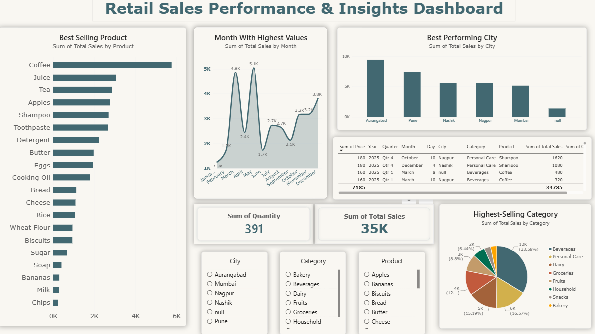

# Retail Sales Performance & Insights Dashboard

## Project Overview
An interactive Power BI dashboard developed to analyze supermarket sales data and transform raw data into meaningful business insights. The project focuses on product performance, monthly sales trends, city-wise revenue, and category contribution.

## Objectives
- Identify the best-selling products.
- Analyze monthly sales performance and peak sales periods.
- Compare sales across cities.
- Understand category-wise sales contribution.
- Provide interactive filters for exploring the data.

## Tools & Technologies
- Microsoft Power BI
- Data Analysis and Visualization
- Interactive Slicers and KPI Cards
- Charts, Tables, and Business Reporting

## Dashboard Features
- **Product Analysis:** Compares total sales across products.
- **Monthly Trends:** Highlights changes in sales throughout the year.
- **City Performance:** Identifies cities contributing the most revenue.
- **Category Analysis:** Shows the contribution of different product categories.
- **KPI Cards:** Displays total sales and total quantity sold.
- **Interactive Filters:** Enables filtering by city, category, and product.

## Key Findings
- Total sales displayed: approximately 35K.
- Total quantity sold: 391.
- Coffee is the leading product by total sales.
- Aurangabad is the highest-performing city in the displayed analysis.
- Beverages contribute the largest share among the displayed categories.

*Note: Findings reflect the current dashboard and should be validated against the underlying dataset.*

## Project Workflow
1. Understood the dataset and its structure.
2. Analyzed sales figures across products, cities, months, and categories.
3. Identified relevant KPIs and business questions.
4. Designed interactive visualizations in Power BI.
5. Created a dashboard to communicate key findings clearly.

## Project Files
- `Retail-Sales-Performance-Dashboard.pbix` — Power BI report file.
- `Supermarket_Sales.xlsx` — source dataset, if permitted to share.
- `dashboard-screenshot.png` — dashboard preview.

## Learning Outcomes
This project strengthened my skills in data analysis, KPI selection, data visualization, interactive dashboard development, and communicating business insights through data.

## Author
Gaurav Barwal

## Dashboard Preview

